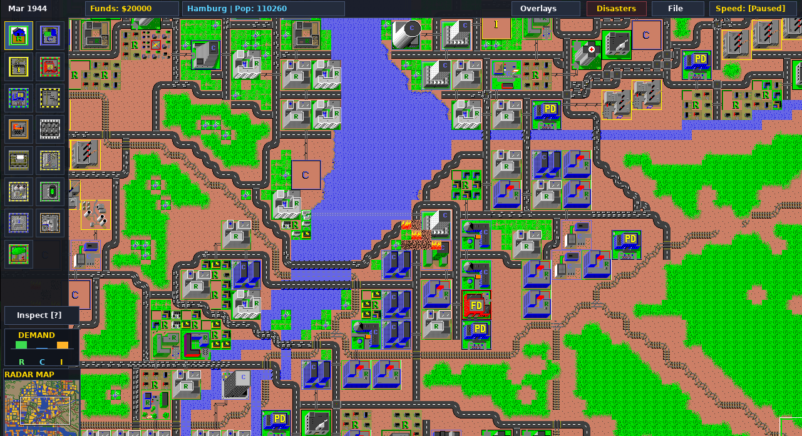

# Micropolis

Micropolis is a city simulation game. You build and manage a city by zoning land, laying roads, rail, and power lines, and providing services such as police, fire protection, and parks. The simulation reacts to your decisions with growth, traffic, pollution, and disasters.

This is a port of the original Micropolis Unix source, refactored from 1989 C to modern C. The simulation engine is kept separate from the frontend, which uses SDL3 on GNU/Linux.

## Controls

### Keyboard

| Key | Action |
| --- | --- |
| Space | Pause or resume the simulation |
| 1, 2, 3 | Set simulation speed |
| X / Z | Next / previous tool |
| B | Hold for bulldozer (release to return to the previous tool) |
| R | Hold for road (release to return to the previous tool) |
| P | Hold for power line (release to return to the previous tool) |
| T | Hold for rail (release to return to the previous tool) |
| Arrow keys, or A / E / , / O | Scroll the map |
| F1 | Toggle help mode |
| F7 | Quick save to `quicksave.cty` |
| F8 | Quick load from `quicksave.cty` |
| Esc | Quit (asks for confirmation); closes an open notice |

### Mouse

| Input | Action |
| --- | --- |
| Left click | Use the selected tool on a tile |
| Left drag | Use the selected tool along a line |
| Right drag | Pan the map |
| Shift + right click | Bulldoze the tile |

Tools are selected from the palette on the left side of the window.
